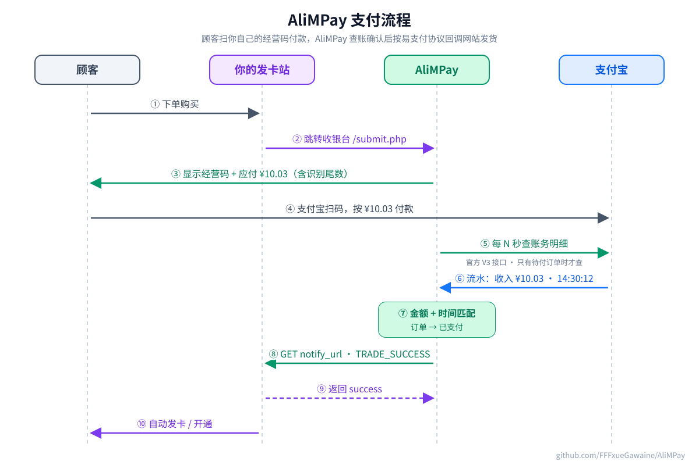
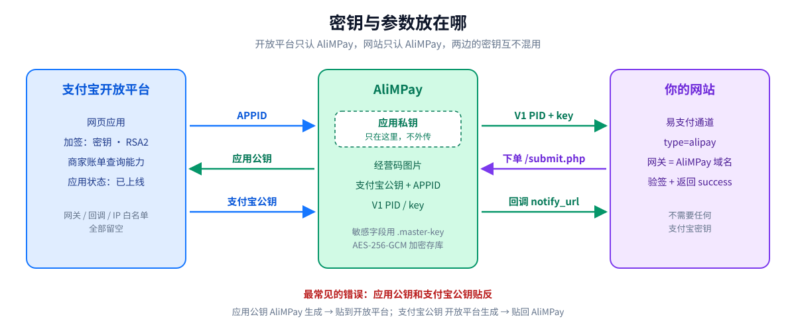
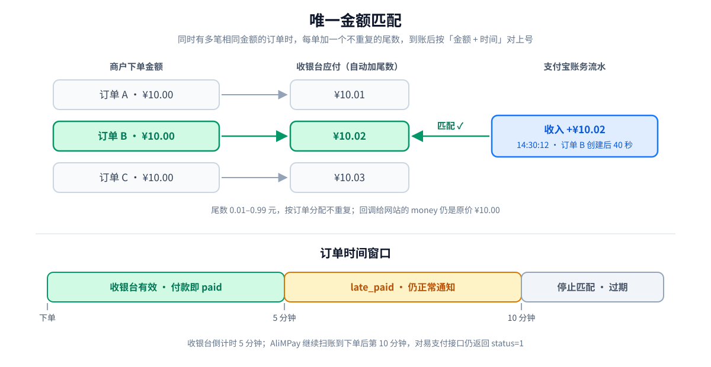

# AliMPay - 自建支付宝码支付（卡网实战版）

本仓库 fork 自 [MiaM1ku/AliMPay](https://github.com/MiaM1ku/AliMPay)（Bun 重写版），在一个线上发卡站跑了一个多月，期间修了扫账卡死的问题，也重做了手机收银台。上游的完整技术说明保留在 [docs/README.upstream.md](docs/README.upstream.md)。

它做的事情很简单：顾客扫你的支付宝经营码付款，AliMPay 每隔几秒通过支付宝开放平台查一次你自己的账务流水，按金额和时间匹配到订单，再按易支付协议回调你的网站。发卡站、独角数卡、dujiao-next、各类中转站，只要支持易支付就能直接接。



## 特性

- 🚀 **自动对账**：调用支付宝官方 V3 账务明细接口，不爬网页、不用 Cookie、不挂手机监听
- 📱 **两种收款方式**：经营码（推荐，按金额匹配）和转账码（按备注匹配订单号）
- 🔢 **唯一金额**：同时有多笔待付订单时，自动给每单加 0.01–0.99 元的识别尾数
- ⏰ **5 + 5 分钟窗口**：收银台 5 分钟有效，第 5–10 分钟到账仍会补记并通知
- 🔐 **易支付兼容**：V1 MD5、V2 RSA 两套签名，下单、查询、异步通知都有
- 🔁 **通知重试**：首次立即发，失败每 60 秒重试，最多 10 次，后台可手动补发
- 💾 **部署轻**：一个 Bun 进程 + SQLite，不需要 MySQL、Redis

不支持：退款、代付、关单、结算、多商户。一个实例只对应一个收款支付宝。

### 本 fork 相对上游的改动

| 改动 | 文件 | 说明 |
| --- | --- | --- |
| 扫账超时保护 | `src/server/alipay.ts` | 线上遇到过支付宝账单请求挂起不返回，扫描器被永久占用，之后的订单全部过期。现在两层超时：账单请求 8 秒强制中断（Bun 1.3 不认 urllib 的分阶段超时，改用 `AbortSignal`）；每页查询最多等 10 秒，超时就释放扫描器，迟到的结果直接丢弃 |
| 关闭 gzip 协商 | `src/server/alipay.ts` | Bun 会自动解压响应，导致 SDK 验签读到的正文不一致；账单请求改发 `accept-encoding: identity` |
| 手机收银台 | `src/web/pages/checkout.tsx` | 改成「付款只需三步」：先核对金额，再显示付款码；已过期 / 已到账 / 订单不存在各有独立页面 |
| 防少付提醒 | `src/web/lib/payment-confirmation.ts` | 把应付金额写成「X 元 X 角 X 分」；尾数像 `20.01` 这种容易被看成 `20.1` 的，会单独提醒「不是 ¥20.10，0 也要输入」 |
| 测试 | `tests/payment-timeout.test.ts`、`tests/alipay-sdk.test.ts` | 覆盖上面的超时和 gzip 验签 |

---

## 一、准备

| 需要 | 说明 |
| --- | --- |
| 一个实名支付宝 | 收款号。开放平台、经营码、AliMPay 必须用**同一个号** |
| 支付宝经营码 | 支付宝搜「经营码」/ 商家服务里申请。进入申请页填商户信息时返回，有时会直接提示免填开通 |
| 一台 Linux 服务器 | 能跑 Docker 或 Bun 1.3+ |
| 一个 HTTPS 域名 | 给 AliMPay 用，下面统一写作 `pay.example.com` |
| 你的网站 | 已经能对外访问，并支持易支付。下面写作 `shop.example.com` |

## 二、支付宝开放平台创建应用

用**收款那个支付宝**登录 <https://open.alipay.com/>。

1. 第一次进入先补开发者信息：联系人、手机、邮箱，服务范围选**自研 / 自己使用**，不要选服务商。
2. 控制台 → **网页/移动应用** → **创建网页/移动应用**：
   - 应用名称：比如「站点账务对账」，别带「支付」「pay」「支付宝」「测试」
   - 应用类型：**网页应用**（创建后改不了）
   - 图标：320×320，自己的图
3. 创建完记下 **APPID**。状态现在是「开发中」，接口还调不通，先放着，等 AliMPay 生成密钥后再回来。

## 三、部署 AliMPay

### 方式 A：Docker Compose（推荐）

```bash
git clone https://github.com/FFFxueGawaine/AliMPay.git /opt/AliMPay
cd /opt/AliMPay
cp .env.example .env
```

编辑 `.env`，最少改这一行：

```dotenv
PUBLIC_BASE_URL=https://pay.example.com
APP_MASTER_KEY=          # 留空，首次启动自动生成 data/.master-key
ALLOW_PRIVATE_CALLBACKS=false
TRUST_PROXY=false        # 前面有 Nginx 反代时改成 true
```

启动并检查：

```bash
docker compose up -d --build
docker compose ps
curl -fsS http://127.0.0.1:3000/healthz
```

### 方式 B：直接跑 Bun

```bash
git clone https://github.com/FFFxueGawaine/AliMPay.git /opt/AliMPay
cd /opt/AliMPay
bun install --frozen-lockfile
cp .env.example .env     # 同样改 PUBLIC_BASE_URL
bun run build
bun run start
```

长期运行用 systemd，单元文件示例见 [上游文档](docs/README.upstream.md#直接部署-bun推荐)。

> 只能跑**一个**进程。扫账合并和通知认领都按单进程设计，开多个副本会重复扫账、重复通知。

### 配 HTTPS 反代

Compose 只监听 `127.0.0.1:3000`，对外由 Nginx / Caddy 提供 HTTPS：

```nginx
server {
    listen 443 ssl http2;
    server_name pay.example.com;
    client_max_body_size 6m;

    location / {
        proxy_pass http://127.0.0.1:3000;
        proxy_set_header Host $host;
        proxy_set_header X-Forwarded-Proto $scheme;
        proxy_set_header X-Forwarded-For $proxy_add_x_forwarded_for;
        proxy_read_timeout 30s;
    }
}
```

如果域名走了 Cloudflare 代理，`X-Forwarded-For` 里拿到的是 CF 边缘 IP，登录限流和审计日志会记错 IP。可以用 `geo` 匹配 CF 网段，再把 `CF-Connecting-IP` 作为真实 IP 传进去。

## 四、生成密钥，回填开放平台

1. 打开 `https://pay.example.com`，设置管理员密码（用户名固定 `admin`），公开根地址填 `https://pay.example.com`。
2. 后台 → **密钥中心** → **支付宝应用密钥** → **生成应用密钥** → **复制应用公钥**。
3. 回到开放平台 → 你的应用 → **开发设置** → **接口加签方式**：选「密钥」、**RSA2**，粘贴刚复制的应用公钥并保存。
4. 开放平台随即给出 **支付宝公钥**，整段复制。
5. 应用网关、授权回调地址、IP 白名单、AES 加密**全部留空**。IP 白名单填错会导致查账失败。



三把钥匙别贴反：

| 名称 | 谁生成 | 放在哪 |
| --- | --- | --- |
| 应用私钥 | AliMPay | 只留在 AliMPay，不外传 |
| 应用公钥 | AliMPay | 贴到开放平台「接口加签方式」 |
| 支付宝公钥 | 开放平台 | 贴到 AliMPay「收款配置」 |

## 五、开通账单权限并上线应用

开放平台 → 应用详情 → **添加能力** → 搜索 **商家账单数据查询及下载接口**（不要加当面付、网站支付），然后**提交审核 / 上线**。

审核一般 1 个工作日。应用还是「开发中」时，AliMPay 的「测试连接」一定失败。个人号有可能卡在这个权限上，个体户 / 企业号通过率更高。

## 六、AliMPay 收款配置

应用变成「已上线」后，后台 → **收款配置**：

| 字段 | 填写 |
| --- | --- |
| 收款方式 | **经营码**（推荐） |
| 经营码图片 | 上传收款号的经营码原图 |
| 应用 ID | 开放平台 APPID |
| 支付宝公钥 | 第四步复制的那段（不是应用公钥） |
| V3 Endpoint | 默认的生产地址，不要改 |
| 支付轮询间隔 | 1–60 秒，默认就行；越短到账越快，调用次数越多 |
| 转账 UID | 只有转账模式需要，经营码模式留空 |

保存 → **测试连接**。

| 报错 | 原因 |
| --- | --- |
| 权限不足 / ISV 相关 | 账单能力没通过 |
| 验签失败 | 公钥贴反，或加签方式不是 RSA2 密钥模式 |
| 应用不存在 | APPID 填错，或应用没上线 |

### 两种收款方式

**经营码（推荐）**：顾客按收银台显示的金额扫码付款，不用填备注。同时有多笔待付订单时，每单金额会加不同的尾数（1.00 → 1.01 → 1.02 …），靠「唯一金额 + 时间」匹配。



**转账码**：生成支付宝转账链接，订单号写进转账备注，靠备注匹配。适合开不了经营码的号。链接有三层可选（原始 `alipays://`、单层 HTTPS、外层 Scheme），哪层在你的手机上能直接唤起支付宝就用哪层。

## 七、接入你的网站（易支付）

后台 → **密钥中心**，复制 **V1 PID** 和 **V1 key**。大多数发卡站用 V1 就够了；V2 RSA 给已经支持新版易支付的程序用，V2 商户私钥只显示一次。

### 通用易支付站点

| 站点里的字段 | 填写 |
| --- | --- |
| 接口类型 | 易支付 / epay |
| 支付方式 | 支付宝（`type=alipay`，只支持这一种） |
| 网关地址 | `https://pay.example.com/` |
| 商户 ID | V1 PID |
| 商户密钥 | V1 key |

### dujiao-next / 独角数卡

后台 → 支付管理 → 支付渠道 → 新建：

- 提供方：**易支付**，版本 **V1**
- 支付类型：支付宝，交互方式：**跳转支付**
- 网关地址：`https://pay.example.com`
- PID / 商户密钥：上面复制的 V1 PID / key
- 异步通知：`https://shop.example.com/api/v1/payments/callback`
- 返回地址：`https://shop.example.com/pay`

### 接口一览

| 方法 | 路径 | 用途 |
| --- | --- | --- |
| GET/POST | `/submit.php` | 页面跳转支付 |
| POST | `/mapi.php` | API 下单 |
| GET/POST | `/api.php?act=query` | 商户信息（需 PID + key） |
| GET/POST | `/api.php?act=order` | 单笔订单查询 |
| GET/POST | `/api.php?act=orders` | 订单列表 |

下单参数至少要有：`pid`、`type=alipay`、`out_trade_no`、`notify_url`、`name`、`money`、`sign`。V2 接口见 [上游文档](docs/README.upstream.md#v2-rsa)。

### V1 签名

```js
// 1. 去掉空值、数组、sign、sign_type
// 2. 按参数名 ASCII 升序，拼成 key1=value1&key2=value2（用原值，不做 URL 编码）
// 3. 末尾直接拼接 V1 key，算小写 MD5
const signStr = "money=1.00&name=测试商品&notify_url=https://shop.example.com/notify&out_trade_no=123&pid=1001&type=alipay";
const sign = md5(signStr + v1Key);
```

### 回调要求

AliMPay 用 **GET** 请求 `notify_url`。你的站点要：

1. 验签，核对订单号和金额，确认 `trade_status=TRADE_SUCCESS`
2. 按 `out_trade_no` 幂等处理，避免重复发货
3. 返回 HTTP 2xx，正文只有 `success`

回调里的 `money` 是原始下单金额，不含识别尾数，站点按原价核对即可。

## 八、拿一笔小额真单验收

「测试连接」成功只说明能查账，还要真付一笔：

1. 在网站下一单 1 元左右的订单，跳到收银台，确认显示的是带尾数的金额（例如 ¥1.01）
2. 用另一个支付宝扫码，**按收银台金额**付款
3. 几秒内收银台变成「已收到」，AliMPay 后台订单变已支付
4. 网站订单变已付款并发货。没变的话看 AliMPay 后台的通知记录：签名不对、没返回 `success`，还是 `notify_url` 不通

---

## 常见问题

**Q：付款后多久能确认？**
A：正常 2–3 秒匹配，匹配后立刻回调。只有存在待付订单时才查账，所以平时不会消耗接口调用。

**Q：顾客付了原价，没付尾数怎么办？**
A：金额对不上就不会自动匹配。收银台已经把金额拆成元角分并提醒「0 也要输入」，但仍可能有人付错。AliMPay 后台没有「手动标记已付」，这种单子请在支付宝账单里核实后，到你的网站后台手动补单，或原路退款让顾客重新下单。

**Q：订单过期了顾客才付款？**
A：第 5–10 分钟到账的记为 `late_paid`，对易支付接口仍是 `status=1`，照常通知。10 分钟后不再自动匹配。

**Q：明明付了款，订单却全部过期？**
A：先查扫描器是不是卡住了。以只读方式打开 `data/alimpay.sqlite`，看 `scan_runs` 表有没有一直停在 `running` 的记录；另一个症状是每次 `/api.php` 查询都正好耗时 3000 ms。本 fork 已经加了超时保护，旧版本遇到这种情况就 `docker restart` 容器。

**Q：匹配不上的其他原因？**
A：经营码和开放平台不是同一个号；钱进了余额宝或其他非余额账户；应用掉回了「开发中」；经营码有手续费，导致到账金额和收银台金额不一致。

**Q：能多开几个实例吗？**
A：不能。一个实例、一个支付宝、单进程。

## 备份

数据都在 `data/`（Docker 里是 `/data`），这三样必须**一起**备份：

- `alimpay.sqlite`（以及 `-wal`、`-shm`）
- `uploads/`（经营码图片）
- `.master-key`（丢了库里所有加密私钥都解不开）

```bash
sqlite3 data/alimpay.sqlite ".backup 'alimpay-$(date +%F).sqlite'"
```

## 开发

```bash
bun install --frozen-lockfile
cp .env.example .env
bun run dev          # 前端 http://localhost:5173，后端 http://localhost:3000
bun run typecheck
bun test tests       # 单元测试
bun run test:e2e     # Playwright 端到端测试（需 bunx playwright install chromium）
```

## 贡献者

- [@FFFxueGawaine](https://github.com/FFFxueGawaine)：本 fork 维护者，线上部署与验收
- [Claude](https://claude.com/claude-code)：扫账超时修复、收银台改版、教程与示意图

## 致谢

- [MiaM1ku/AliMPay](https://github.com/MiaM1ku/AliMPay)：Bun 重写版，本仓库的上游
- [ours1505/AliMPay](https://github.com/ours1505/AliMPay)：最早的 PHP 版，作者在 [NodeSeek](https://www.nodeseek.com/post-394171-1) 发过介绍帖

## 免责声明

本项目仅供学习交流。使用者需遵守相关法律法规和《支付宝服务协议》，只用于收取自己正当经营的款项。不要拿个人收款码替不特定的第三方代收，这类用法会被支付宝风控停权限，也可能违法。
